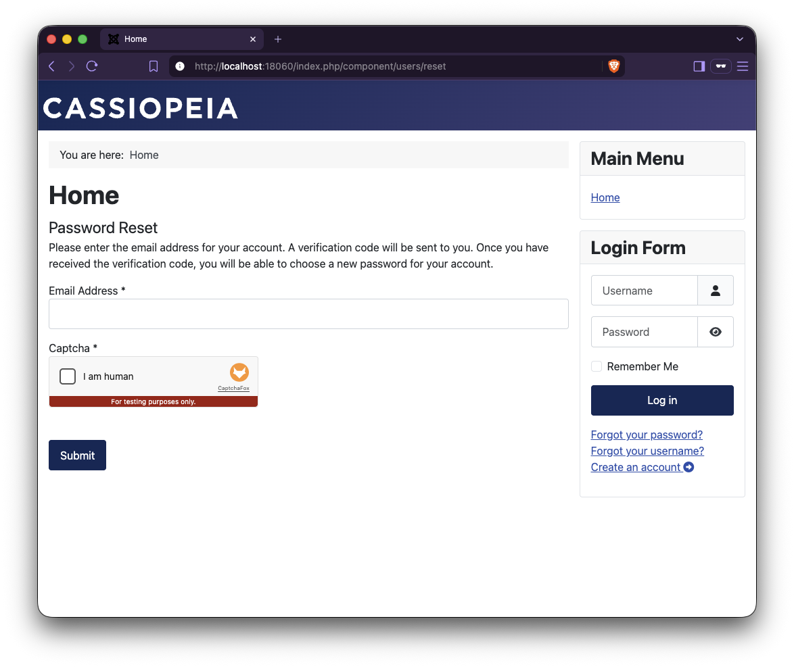

# CaptchaFox for Joomla

Official [CaptchaFox](https://captchafox.com) integration for Joomla. It renders the CaptchaFox widget in
the forms that use Joomla's captcha field and verifies every answer on the server.

  

## Compatibility

| Joomla | Plugin | PHP |
|---|---|---|
| 5.4 or later | 1.x | 8.1 or later |
| 6.x | 1.x | 8.3 or later |

Joomla 3, 4, 5.0–5.3 and 7 are not supported. The installer rejects them.

## Installation

Download `plg_captcha_captchafox-<version>.zip` from the
[releases](https://github.com/CaptchaFox/captchafox-joomla/releases). In the Joomla administrator, go
to **System → Install → Extensions** and upload the ZIP.

## Configuration

### Get your keys

In the [CaptchaFox portal](https://portal.captchafox.com), open your website under **Sites > Site
Details** and copy the **site key** and the **secret key**.

### Set up the plugin

Go to **System → Manage → Plugins**, search for "CaptchaFox" and open **Captcha - CaptchaFox**:

1. Enter the **Site Key** and the **Secret Key**.
2. Set **Status** to **Enabled**.
3. Keep **Access** at **Public**. With any other access level, Joomla cannot use the plugin for
   visitors and rejects their forms (see [Troubleshooting](#troubleshooting)).
4. Click **Save & Close**.

Then choose the forms, see [Usage](#usage).

### Options

| Option | Default | Meaning |
|---|---|---|
| Mode | Inline | Inline, Popup, or Hidden: no widget, the check runs on submit |
| Theme | Light | Light or Dark |
| Start | On click | When the check starts: On click, On form focus, Automatically |
| Language | Language of the site | Language of the site, of the browser, or a fixed language |
| If CaptchaFox Is Unreachable | Let the form through and log it | See [If CaptchaFox is unreachable](#if-captchafox-is-unreachable) |

## Usage

The plugin works through Joomla's captcha interface, so it protects every form that uses Joomla's
captcha field. In Joomla itself these are:

- contact form
- user registration
- "Forgot your username?"
- "Forgot your password?"
- article submission in the frontend

Form extensions that bring their own captcha integration (for example form builders) are not covered.

### Choose where CaptchaFox is used

CaptchaFox has no switch per form. Joomla decides which captcha a form uses, on two levels.

**Site-wide:** Go to **System → Global Configuration**, tab **Site**, set **Default Captcha** to
"Captcha - CaptchaFox" and save. From then on, all [protected forms](#usage) show CaptchaFox,
as long as the components below keep their default "Use Global".

**Per component (optional):** A component can use a different captcha or none. Open the component,
click **Options** in the toolbar (top right) and change the option:

| Component | Tab | Option | Applies to |
|---|---|---|---|
| Components → Contacts | Form | Allow Captcha on Contact | all contact forms |
| Users → Manage | User Options | Captcha | registration, "Forgot your username?" and "Forgot your password?" together |
| Content → Articles | Editing Layout | Allow Captcha on submit | article submission in the frontend |

Each option offers **Use Global** (the default), **None**, or a specific captcha plugin.

Good to know:

- A single contact or menu item cannot switch the captcha on or off. All contact forms behave the same.
- Joomla's login form has no captcha.
- A form only appears if its feature is on. Registration, for example, needs **Allow User
  Registration** (Users → Manage → Options → User Options).
- The captcha is also shown to logged-in users.

### How a form is checked

- **In the browser:** A form is only sent once the widget has been solved. Otherwise a hint appears
  at the widget ("Please confirm that you are human."). Cancelling, for example in the article form,
  is never blocked. In hidden mode the check runs automatically on submit.
- **On the server:** Every answer is verified with CaptchaFox before Joomla processes the form. The
  browser check is only a convenience; the server-side verification decides.
- **Plugin disabled while still selected:** If CaptchaFox is still selected as captcha but the plugin
  is disabled or its access level is not Public, forms are rejected instead of being accepted without
  a check, and visitors see "Captcha not available".

## Operation

### If CaptchaFox is unreachable

When the server cannot reach CaptchaFox (network error, timeout of 5 seconds, error response), the
option "If CaptchaFox Is Unreachable" decides. By default the form is let through and the outage is
logged, so an outage at CaptchaFox does not lock visitors out of your forms. Choose "Block the form"
if protection matters more to you than availability. Answers that CaptchaFox rejects are always
rejected.

### Log

Outages are written to `plg_captcha_captchafox.php` in Joomla's log folder
(Global Configuration → Logging → "Path to Log Folder"). Rejected answers are only logged when
Joomla's debug mode is on. The secret key is never logged.

### Visitor IP

The plugin sends CaptchaFox only the answer of the widget and the secret key, not the visitor's IP
address. Reverse proxies and load balancers need no setup.

### Content Security Policy

If your site sends a Content Security Policy, for example with the core plugin
"System - HTTP Headers", allow CaptchaFox in these directives. Keep your existing values such as
`'self'`, which the plugin's own script needs.

| Directive | Add |
|---|---|
| `script-src` | `https://*.captchafox.com blob:` |
| `connect-src` | `https://*.captchafox.com` |
| `style-src` | `https://*.captchafox.com` |
| `img-src` | `https://*.captchafox.com` |
| `media-src` | `https://*.captchafox.com` |

- If you set `worker-src` or `child-src`, add `blob:` there as well. The widget runs a web worker from
  a `blob:` URL.
- The widget script is loaded from `https://cdn.captchafox.com/api.js`. It cannot be bundled or
  self-hosted, and Subresource Integrity (SRI) is not possible because its URL is not versioned.
- With "Nonce" enabled in "System - HTTP Headers", Joomla adds the nonce to the plugin's scripts
  automatically.

### Page cache

The widget markup contains no inline script and no session data, so it works with Joomla's page cache
and with a nonce-based Content Security Policy. For combining both, see
[Troubleshooting](#troubleshooting).

### Privacy

CaptchaFox is operated by Scoria Labs GmbH, Germany. How CaptchaFox processes data and how to get a
data processing agreement is described in the [CaptchaFox Privacy Center](https://captchafox.com/privacy).
A suggested paragraph for your privacy policy is on the
[GDPR page](https://captchafox.com/privacy/gdpr).

## Troubleshooting

### "CaptchaFox is not configured yet"

The site key or the secret key is missing. Enter both in the plugin settings.

### "Captcha not available. This form cannot be sent at the moment."

CaptchaFox is selected as captcha, but Joomla cannot use the plugin: it is disabled, or its access
level is not Public. Enable the plugin and set its access level to Public, or select another captcha.

### "Please confirm that you are human." although the widget was solved

The confirmation is only valid for a short time. Solve the widget again and send the form.

### "The captcha could not be verified right now"

The server could not reach the CaptchaFox API, and the option "If CaptchaFox Is Unreachable" is set to
"Block the form" (the default lets the form through).
Check that the server can open HTTPS connections to `api.captchafox.com`. If your server needs a proxy,
set it in Joomla's Global Configuration (Server → "Enable Outbound Proxy"); the plugin uses it. Details
are in the log file `plg_captcha_captchafox.php`.

### Scripts are blocked on cached pages when a CSP nonce is used

**Symptom:** With "System - Page Cache" and a Content Security Policy with "Nonce" enabled, the
widget or other scripts do not load for some visitors. The browser console reports Content Security
Policy violations.

**Cause:** This is a general Joomla limitation, not specific to CaptchaFox. The page cache stores the
complete page, including the nonce of the visit that filled the cache. Later visitors get a new nonce
in the CSP header, so every script that relies on the nonce alone is blocked.

**CaptchaFox is not affected** as long as your policy allows `https://*.captchafox.com` (see above),
`'self'` is allowed in `script-src`, and "strict-dynamic" is disabled: the browser then accepts these
scripts by their origin. With "strict-dynamic" enabled, the browser ignores origins and relies on the
nonce only.

**Solutions:**

- Exclude pages with forms from the page cache ("System - Page Cache", options "Exclude Menu Items" or
  "Exclude URLs"), or
- do not combine the page cache with a nonce-based policy that uses "strict-dynamic".

### Content Security Policy reports inline styles of the widget

Without `'unsafe-inline'` in `style-src`, the browser may report blocked inline style attributes
(`style-src-attr`) of the widget. These reports are harmless; the widget keeps working.

## License

GPL-2.0-or-later. See [LICENSE](LICENSE).
